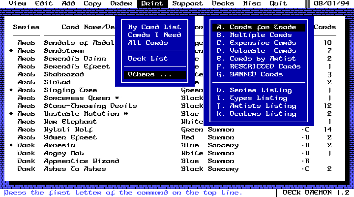

# Deck Daemon

Deck Daemon is a **Magic: The Gathering® collection tracker and deck builder** for the PC, published in 1994-1995 by **Bard's Quest Software, Inc.** of Boise, Idaho. It started as a DOS program written in CA-Clipper 5.2, and a Windows version built on Microsoft FoxPro 2.6 followed in mid-1995.

This repository is an **archive**. It holds the original DOS source code, the released DOS and Windows programs, the update and price guide disks that went with them, and scans of the packaging and screens. Nothing here has been modernized: the code and binaries are exactly as they were in the mid-1990s.

## What Deck Daemon did

- Tracked a **card collection** by series, condition (mint, near mint, light use, heavy use), quantity, purchase price and sale price.
- Built and saved **decks** and sideboards, with deck statistics and a random-draw playtester.
- Priced a collection from **Conjure on Disk** and **Scrye on Disk** electronic price guides.
- Took **updates** for new expansions (The Dark, Fallen Empires, Ice Age, Chronicles, Alliances) and add-on deck collections (Daemon Decks).
- Printed reports, or wrote them to a text file.

Version 1.2 for DOS sold for around $29.95. Deck Daemon was one of several early unofficial Magic utilities, alongside programs such as Apprentice, Magic Workstation and CardMaster.

## Repository layout

| Path | Contents |
| --- | --- |
| `src/dos/` | Clipper source for the DOS programs. See [src/dos/readme.md](src/dos/readme.md). |
| `src/windows/` | FoxPro source for the Windows version (written by Dave Armga), recovered by decompiling `DAEMON.EXE`. See [src/windows/README.md](src/windows/README.md). |
| `releases/dos/deck daemon/v1.2/` | Deck Daemon 1.2 for DOS (`DAEMON.EXE`, `INSTALL.COM`, card and deck databases). |
| `releases/dos/updates/` | Expansion update disks: The Dark, Fallen Empires, Chronicles, Alliances, and On the Edge data. |
| `releases/dos/daemon decks/v1/` | Daemon Decks volume 1, a set of prebuilt decks for DOS and Windows. |
| `releases/dos/price guides/` | Conjure on Disk (v2-v8), Scrye on Disk (v4, v5) and the Price Guide Browser (`VIEW.EXE`). |
| `releases/windows/` | Deck Daemon for Windows (FoxPro 2.6 runtime, databases, help file, sample decks, price guides). |
| `images/` | Logos, box and disk scans, splash screens and screenshots. |

The original source for the **Windows version** was lost. It was written in FoxPro 2.6 for Windows, and `src/windows/` holds source recovered by decompiling the released program. Comments and the visual screen designs could not be recovered; see [src/windows/README.md](src/windows/README.md) for what was and wasn't.

## Running it

These are 16-bit programs. They will not run directly on 64-bit Windows, macOS or Linux.

**DOS version.** Use [DOSBox](https://www.dosbox.com/) or DOSBox-X:

1. Copy `releases/dos/deck daemon/v1.2/` to a folder, for example `C:\DOSGAMES\DAEMON`.
2. In DOSBox, `mount c C:\DOSGAMES` then `c:` and `cd daemon`.
3. Run `DAEMON`.

`DAEMON.EXE` accepts these command-line options, which can be combined: `BW` (monochrome), `CGA`, `NOFONT` (skip the custom character set), `NOTITLE` (skip the splash screen), `NOMOUSE`, `FASTMOUSE`, `NOBUTTONS`, `LOWMEMORY` and `INVENTORY`.

The program writes to its own folder (it rebuilds its index files and saves your collection there), so run it from a writable copy, not from the repository checkout.

**Windows version.** Run Windows 3.1 inside DOSBox-X, PCem or 86Box, copy `releases/windows/` into it and run `DAEMON.EXE`. On 64-bit Windows, a 16-bit compatibility layer such as otvdm (winevdm) may also work, but this has not been tested. `releases/windows/README.TXT` covers importing a DOS 1.2 collection and the video driver problems seen at the time.

## Building the DOS source

The source has not been rebuilt for this archive. To rebuild it you would need:

- **CA-Clipper 5.2** (the headers name 5.2c and 5.2d; `DAEMON.EXE` was built with 5.2c) with the standard `inkey.ch` header and the DBFNTX driver.
- **dCLIP** from Donnay Software, which supplies the `DC_*` mouse, menu and read functions used throughout `daemon.prg`.
- A linker that provides `SWPRUNCMD()`, used to shell out to `FONT.EXE`. This is a Blinker function.

No make or link scripts survive. [Harbour](https://harbour.github.io/) can compile most Clipper 5.2 code, but the dCLIP calls would need to be stubbed or replaced.

The `.prg` files are in **code page 437** with CRLF line endings, so GitHub shows their box-drawing characters as garbled text. Open them with a CP437-aware editor to see them as intended.

## Gallery

| | |
| --- | --- |
|  |  |
|  |  |
|  |  |
|  |  |
|  |  |

## License

The source code in `src/` (the DOS version and the recovered Windows version) and the documentation written for this archive are released under the [MIT License](LICENSE). The programs, data, price guides, runtime files and artwork in `releases/` and `images/` are included for historical preservation and remain the property of their owners. See [NOTICE](NOTICE) for details.

Magic: The Gathering is a trademark of Wizards of the Coast LLC. This project is not affiliated with or endorsed by Wizards of the Coast.
